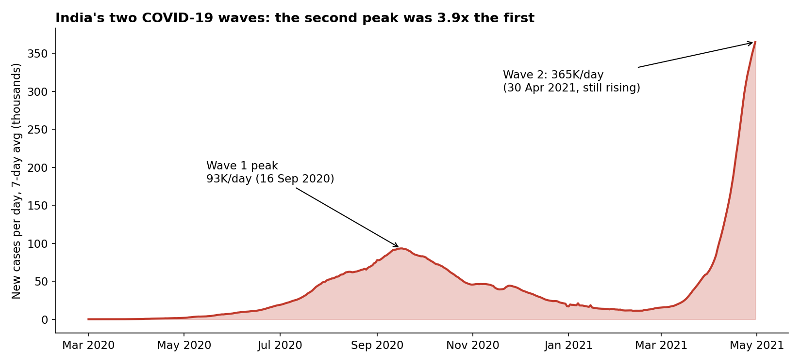
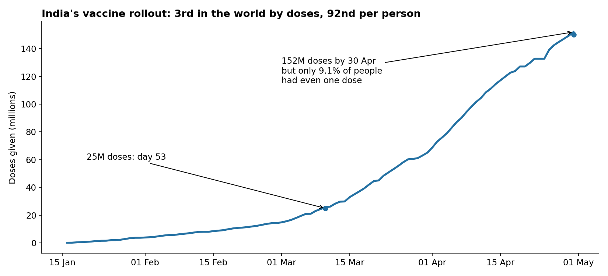
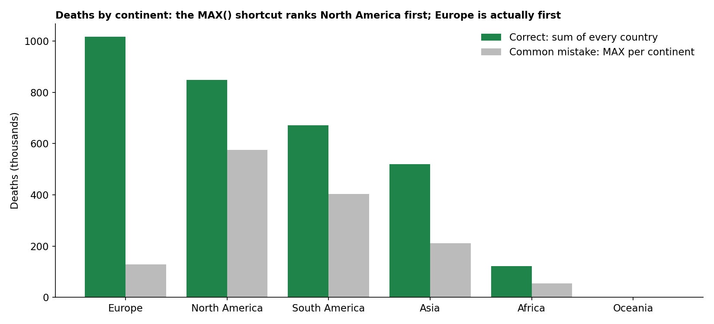

# India and COVID-19: A SQL Analysis of Cases, Deaths and Vaccination

An analysis of how COVID-19 spread through India between January 2020 and April 2021, how India compares with the rest of the world, and how fast its vaccine rollout was moving when the second wave hit. All analysis is written in PostgreSQL.



## Questions


1. How did India's two waves compare in size and speed?
2. Did testing keep up with the spread of the virus?
3. Where does India rank globally, in absolute terms and per person?
4. Why was India's death rate lower than the world average?
5. How fast was India vaccinating, and how far did it still have to go?

## Dataset

Daily country-level COVID-19 data from Our World in Data (compiled from WHO and national sources), split into two tables:

| Table | Rows | Columns | Contents |
|---|---|---|---|
| `covid_deaths` | 85,171 | 26 | cases, deaths, population, hospitalisation |
| `covid_vaccinations` | 85,171 | 37 | tests, vaccinations, demographics |

Coverage: 210 countries, 1 Jan 2020 to 30 Apr 2021. Both tables share the key `(location, date)`.

## Key findings

**The second wave was almost four times the first, and still rising.** Wave 1 peaked at about 93,000 new cases a day (7-day average, 16 Sep 2020). By 30 Apr 2021 Wave 2 had reached 365,000 a day. Weekly cases grew 39–71% week over week through late March and April 2021, and April alone (6.9M cases) accounted for more than a third of all cases India had recorded.

**Testing fell far behind.** Weekly test positivity dropped to 1.6% in February 2021, then climbed to 19.8% by the week of 19 April, roughly four times the WHO's 5% threshold for adequate testing. Confirmed cases in April are therefore very likely an undercount.

**India ranks high in totals, mid-table per person.** India had the 2nd-most cases and 4th-most deaths in the world, but ranked 100th of 190 countries in deaths per million (153.5, against roughly 1,700–1,900 in the US, UK and Brazil).

**A young population is the clearest explanation for the lower death rate.** India's case fatality rate was 1.11% against 2.11% worldwide. Splitting countries into quartiles by median age shows deaths per million rising steadily with age: 42 in the youngest quartile, 259 in India's quartile (median age 22–30), 512 in the third and 977 in the oldest. India's median age is 28.2.

**Monthly fatality rates during a surge are misleading.** India's monthly case fatality rate fell to 0.52% in March 2021 and 0.70% in April. This is not because the virus got milder: deaths lag cases by two to three weeks, so a month of fast-rising cases always shows an artificially low death rate.

**The vaccine rollout was big in absolute terms but small per person.** India gave 152 million doses by 30 April 2021, 3rd in the world after China and the US. Per 100 people it ranked 92nd of 191 countries, with 9.1% of the population having at least one dose and 1.9% fully vaccinated. The pace was accelerating (53 days to reach the first 25M doses, 11 days for the last 25M), but at April's average of 3.1M doses a day, two doses for every Indian would have taken about 2.3 more years.



## Data quality issues found and fixed

These checks are in [`sql/02_data_quality.sql`](sql/02_data_quality.sql).

1. **Aggregate rows inside the country column.** `location` includes rows like `World`, `Asia` and `European Union` (identified by `continent IS NULL`). Summing without filtering them out double-counts everything.
2. **Daily vaccinations have gaps.** India's `SUM(new_vaccinations)` is 142.6M, but the reported total is 152.0M, because 7 days since rollout have no daily figure. A running sum of daily doses undercounts, so the analysis uses `total_vaccinations` with a forward-fill.
3. **Doses are not people.** One person can receive two doses, so "% of population vaccinated" must use `people_vaccinated`, not total doses.
4. **Deaths by continent: a common mistake.** `MAX(total_deaths) ... GROUP BY continent` returns the single worst-hit country in each continent, not the continent total. For North America it returns only the US figure. Summing each country's total instead changes the answer: Europe (1.02M deaths), not North America, had the highest toll.



## SQL techniques used

Joins across tables on a composite key, CTEs, window functions (`LAG`, `RANK`, `ROW_NUMBER`, `NTILE`, running `COUNT`), moving averages with `ROWS BETWEEN 6 PRECEDING AND CURRENT ROW`, forward-filling missing values, `DISTINCT ON`, `FILTER` clauses, `generate_series`, `NULLIF` to guard against divide-by-zero, and views for BI tools.

## Repository structure

```
├── data/
│   ├── covid_deaths.csv
│   └── covid_vaccinations.csv
├── sql/
│   ├── 01_schema.sql          create tables and load the CSVs
│   ├── 02_data_quality.sql    checks run before any analysis
│   ├── 03_india_trends.sql    snapshot, monthly trend, waves, testing
│   ├── 04_india_vs_world.sql  global ranks, neighbours, age analysis, continents
│   ├── 05_vaccination.sql     rollout progress, milestones, projections
│   └── 06_views.sql           reusable views for Tableau / Power BI
└── images/                    charts used in this README
```

## How to run

Requires PostgreSQL 13 or later.

```bash
createdb covid
psql -d covid -f sql/01_schema.sql      # run from the repo root so the CSV paths resolve
psql -d covid -f sql/02_data_quality.sql
psql -d covid -f sql/03_india_trends.sql
psql -d covid -f sql/04_india_vs_world.sql
psql -d covid -f sql/05_vaccination.sql
psql -d covid -f sql/06_views.sql
```

## Limitations

The data ends on 30 April 2021, before the peak of India's second wave in May 2021, so it shows the wave's rise but not its peak or decline. Reported cases depend on testing, which was clearly insufficient in April 2021. Testing figures are incomplete for some countries (Brazil, for example), so cross-country testing comparisons should be read with caution. The age analysis shows a correlation across countries, not proof of cause.

## Acknowledgements

The dataset and the idea of a COVID-19 SQL portfolio project come from the widely used Alex the Analyst tutorial. This version is rebuilt from scratch with an India focus, data quality checks, and corrected aggregation logic.
